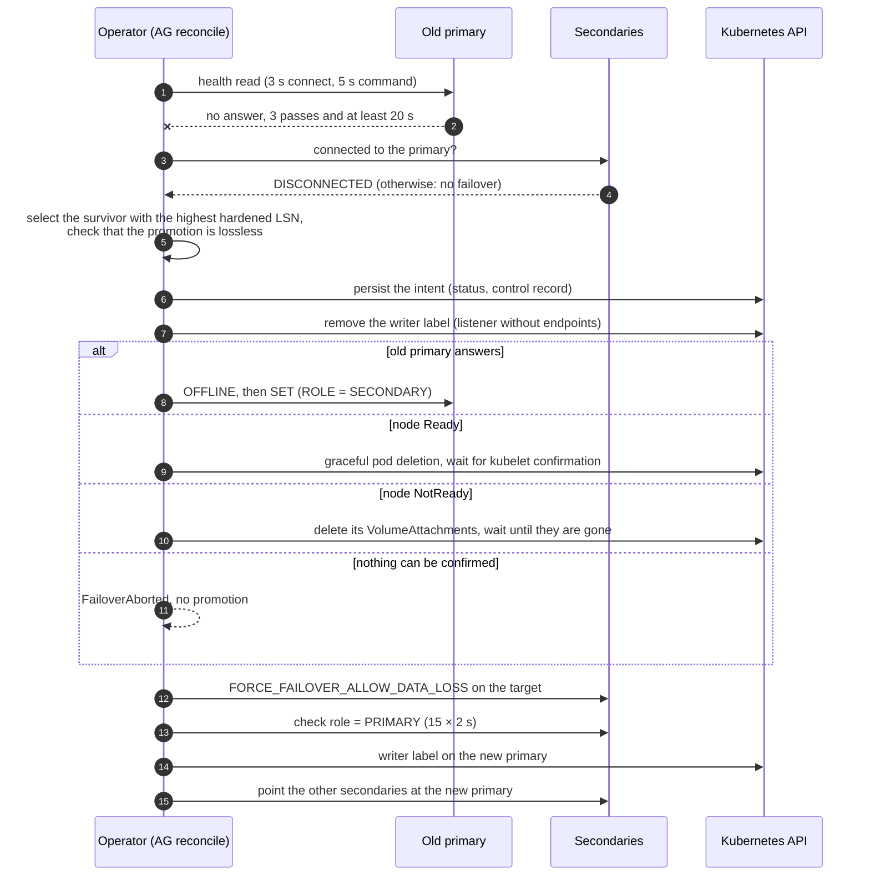

# Availability group internals

This chapter describes how the operator runs an availability group: the SQL Server behaviour it relies on, the Kubernetes objects, the health pass, the automatic failover from detection to promotion, planned and forced failovers, durability profiles, rolling updates, database seeding and lost nodes. The behaviour seen from outside, failure by failure, is in [Failure modes](../failure-modes.md).

Everything in this chapter serves two invariants: at most one replica accepts writes, and no acknowledged commit is lost without a human decision.

## SQL Server behaviour without a cluster manager

Every AG is created with `CLUSTER_TYPE = NONE` and `FAILOVER_MODE = MANUAL`. In this mode SQL Server replicates the log and enforces the commit rule, but it never fails over and never demotes a replica on its own.

The commit rule is what the whole design relies on. `REQUIRED_SYNCHRONIZED_SECONDARIES_TO_COMMIT`, noted *k* below, is the number of synchronous secondaries that must harden a transaction's log before the primary acknowledges the commit. With *k* = 1, a commit that the client saw succeed exists on the primary and on at least one synchronized secondary, and when no secondary is available, commits block. The engine enforces this at commit time, whatever the operator is doing, which is why the operator can build on it.

The only promotion command of a clusterless AG is `FORCE_FAILOVER_ALLOW_DATA_LOSS`. Despite its name, it loses nothing when the target already holds every acknowledged commit, so the first task of the operator is to choose such a target. The command has no effect on the old primary, though. If the old primary is still running, it keeps its role and keeps accepting writes on its open connections and on its pod address. Before any promotion, the operator therefore has to establish that the old primary can no longer write, and most of the failover protocol is built around that proof.

What this mode does not provide is everything a cluster manager adds: a quorum, an arbiter, fencing, and a notion of which replica is legitimately primary. The operator implements these from outside the engine.

## Kubernetes objects

An AG named `orders` with three replicas consists of:

- a StatefulSet `orders` with the pods `orders-0`, `orders-1` and `orders-2`, each with its data, log and backup volumes, and `podManagementPolicy: Parallel`, so that a replica that is down does not delay the start of the others;
- a headless Service `orders-headless`, which gives each replica a stable DNS name for the database mirroring endpoints on port 5022;
- the Service `orders-listener`, which selects the pod labelled `mssql-operator.evariops.com/listener-ready=writer`, and the Service `orders-ro`, which selects the pods labelled `mssql-operator.evariops.com/read-only-target=true`;
- a PodDisruptionBudget allowing one eviction at a time;
- one endpoint certificate per replica, created on that replica, whose public key is imported by the others while the private key never leaves the replica;
- the Secrets holding the machine key and the key backups ([Key material](../guide/protecting-data.md#key-material)), and a [control record](safety.md#control-record-and-intents).

Routing is driven by labels. Since the listener follows the writer label, moving the primary means moving a label, which is a Kubernetes API call that works regardless of the state of the SQL Server pods. During a failover, the operator removes the writer label from every pod, which leaves the listener without endpoints: no client can write until a new primary is confirmed. At safety level 2, the listener selects a single pod by name instead, and that name is changed only by a failover ([Safety levels](safety.md#safety-levels)).

The AG is created in a fixed order. The operator waits for every pod to be ready, creates each replica's certificate, imports every public key and endpoint login on the other replicas, creates the AG on replica 0, joins the secondaries, applies the AG settings and labels the pods. Each step is idempotent, so a reconcile interrupted halfway resumes from what the current state shows.

## Health pass

Every 10 seconds, the AG controller reads on every replica the role it reports, the connection and synchronization state of each replica, and the synchronization state and `last_hardened_lsn` of each database. The primary's view of its secondaries is authoritative. A secondary only knows its own role, and a secondary that has lost its primary reports itself `NOT SYNCHRONIZING`, which says nothing about how much log it holds.

While a primary answers, the controller also records two facts taken from the primary's view: which secondaries are synchronized (`status.lastSynchronizedReplicas`), and the current value of *k* (`status.lastRequiredSynchronizedSecondaries`). They are the last information the primary gives before it disappears, and they are what later tells the operator whether some survivor necessarily holds every acknowledged commit.

## Automatic failover

The automatic failover is implemented in [`AgFailoverOrchestrator`](../../src/MsSqlOperator/Services/SqlServer/AgFailoverOrchestrator.cs). It goes through four steps (detection, target selection, isolation of the old primary, promotion), and each of the last three can stop it.

### Detection

A health read that finds no primary does not mean that the primary is lost: the operator itself may be the one that is cut off. Detection therefore combines several signals before starting a failover.

The primary must have been missing for `failover.primaryUnreachableThreshold` passes (3) and for at least 20 seconds. Counting passes alone turned out not to be a delay: each pass writes the status, the write triggers a new reconcile, and three passes could occur within about twenty seconds, so a brief network interruption was enough to promote a secondary.

The secondaries also have a say. A reachable secondary that is still `CONNECTED` to the primary is receiving its log, which proves the primary is alive and that only the operator cannot reach it. In that case the counter is reset and the operator publishes `PrimaryUnreachableFromOperator` instead of failing over; a failover there would stop a working primary because of the operator's own network problem.

Two other situations are explicitly not treated as a lost primary. A replica that answers and refuses the operator's `sa` login, typically during a password rotation, is alive. And while the rolling update is restarting the primary in place, the automatic failover is disarmed, since a crash recovery longer than the detection window would otherwise lead the operator to fence a pod that is only starting.

### Target selection

The candidates are the reachable secondaries, minus those running an older SQL Server major version than the last primary, because an older build cannot redo a newer log. They are ranked by the number of databases for which they hold the highest hardened LSN, then by `failover.preferredTargets`, then by synchronous commit, then by whether they were synchronized at the last observation of the primary, and finally by name.

Being the most advanced survivor is not enough for the promotion to be lossless. The best candidate is considered lossless only when four conditions hold:

1. it holds the highest hardened LSN of every database;
2. *k* was at least 1 at the last observation of the primary, so no commit was acknowledged without a synchronized secondary;
3. at least one secondary was synchronized at that observation;
4. every secondary synchronized at that observation is reachable now.

Conditions 2 to 4 ensure that every acknowledged commit exists on some reachable survivor, and condition 1 that the chosen candidate holds the most log among them, and therefore every such commit.

When these conditions do not hold, the operator does not promote. It raises `NeedsAttention` with reason `NoLosslessFailoverTarget`, with a message that names the failed condition. The message also points out that an old primary cut off from its secondaries but not from its clients may still be committing alone, and that a forced failover would discard those commits. Only `failover.allowAutomaticDataLossFailover: true` lets the operator force a promotion in that situation, and even then it refuses during a rolling update, when replicas may run different builds, and when `maxDataLossKb` is set, since the amount of unsent log cannot be measured without the primary.

One more case is refused: when the status does not say which replica was the previous primary, because it was lost or because it names the target itself, the operator cannot tell which replica may still be writing. It then promotes only if every other replica answers and none of them reports itself primary, and raises `FailoverRefusedUnknownPrimary` otherwise.

### Isolating the old primary

Before its first effect, the failover makes sure that it will be able to finish. It opens a connection to the target, so that a promotion that cannot reach its target does not leave the old primary without its writer label. It asks the [actuation gateway](safety.md#actuation-gateway) whether the promotion, its last step, would be allowed; in `Plan` or `Observe` mode, or while a forced failover waits for approval, the answer is no and the failover does nothing. An earlier version removed the writer label and demoted the old primary before the promotion was withheld, and the test AG stayed without a primary for twelve minutes. Finally, it persists its intent in the status and in the control record, so that an operator restarted in the middle of the failover resumes or abandons it rather than starting a second one.

The writer label is then removed from the old primary, and the actual isolation depends on what can be reached:

- If the old primary answers, it is taken `OFFLINE` and then given `SET (ROLE = SECONDARY)`, the documented procedure for clusterless AGs. The second statement often fails with error 41104 right after the first, because the transition to `RESOLVING` is asynchronous, so it is retried a few times.
- If it does not answer and its node is Ready, the pod is deleted with a grace period capped at 30 seconds, and the fencing waits until the kubelet confirms that the containers are stopped.
- If its node is NotReady, the kubelet cannot confirm anything. The fencer deletes every VolumeAttachment of the pod's volumes and waits until they are gone, for up to `splitBrainProtection.fencingTimeoutSeconds` (30 seconds). Without its volumes, the engine cannot commit, whatever the process does on the partitioned node.

The 30-second cap on the grace period matters for frozen processes: a frozen SQL Server answers neither the `CHECKPOINT` of its `preStop` hook nor `SIGTERM`, and with the pod's own 180-second grace period, only the final `SIGKILL` stopped it, three minutes later. Storage that does not use VolumeAttachments (`attachRequired: false`, as with NFS, local-path or hostPath) cannot confirm a detachment at all, and the fencer then reports the fencing as not confirmed instead of assuming it.

The fencer is [`ReplicaFencer`](../../src/MsSqlOperator/Services/Breakout/ReplicaFencer.cs). Its waits span several reconciles: the state is persisted in `status.fencing`, and each reconcile performs a bounded amount of work, including up to 45 seconds of polling for a graceful deletion. A fencing that cannot be confirmed ends with `FailoverAborted`. No promotion takes place, and if the old primary still answers as primary, its writer label is restored, so that an aborted failover does not turn into an outage of a primary that was working.

### Promotion

The target receives `FORCE_FAILOVER_ALLOW_DATA_LOSS` through the gateway. The command returns before the role change is visible, so the operator polls the target's role, 15 times at 2-second intervals, before touching the labels; if the role never becomes `PRIMARY`, labels and status are left unchanged and `FailoverUnconfirmed` is published. If the old primary was demoted in the same reconcile and the promotion fails, the old primary is promoted back, since it holds every commit and an AG without a primary is the worst outcome.

Once the role is confirmed, the writer label is set on the new primary and the listener follows. `status.lastFailover` records the time, the source, the target, the reason and whether data could have been lost. The old primary, if it was demoted, joins as a secondary, and the other secondaries are explicitly pointed at the new primary. This last step was added after the chaos campaigns: following a clusterless failover, a third replica could remain `SUSPEND_FROM_PARTNER` in the new primary's view while reporting no problem locally, `HADR RESUME` did not fix it, and that replica never resynchronized without the re-attachment.

### Return of the old primary

Fencing establishes the isolation at the time of the promotion, and no later. The StatefulSet recreates the deleted pod, and its SQL Server starts from its local AG metadata, which still says `PRIMARY`, since nothing could demote it while it was unreachable. For a few seconds, two replicas report the primary role.

The operator expects this. For 90 seconds after a failover, it reconciles the AG every second and probes the old primary. As soon as the old primary answers as primary, it is taken `OFFLINE` and then set to secondary (`ResurrectedPrimaryDemoted`). The writer label is not restored on it, so clients do not reach it through the listener in the meantime.

Two primaries are resolved automatically only in that situation, when they are exactly the source and the target of the last recorded failover; the operator then demotes the source, because its own record says which one is legitimate. Any other combination is a split brain without an arbiter. The operator removes the writer label from every pod and raises `NeedsAttention` with reason `SplitBrain`, with the replica names and the commands to resolve it manually, rather than choosing a survivor that might be the wrong one.

The seconds during which the old primary reports itself primary have one more consequence: another secondary can connect to it and synchronize from it. After a lossless failover, the operator re-attaches that secondary to the new primary. After a failover with data loss, that secondary may now hold commits that the new primary never had, so it is treated as divergent, like the old primary ([Forced failovers and divergence](#forced-failovers-and-divergence)).

### Measured durations

The chaos campaigns measured the longest interval between two acknowledged commits, with a client committing every 100 ms through the listener:

| Failure | Write gap | Data lost |
|---|---|---|
| planned failover | 1.6–3.8 s | none |
| primary pod deleted, graceful or forced (restarts as primary before the detection window ends) | 12.7–16.6 s | none |
| `sqlservr` killed | 17.5–18.0 s | none |
| primary frozen (`SIGSTOP`) | 96.8–104.3 s | none |
| primary isolated from everything | 83.0–120.4 s | none |

For hard failures, the time goes to detection (at least 20 seconds, usually about 30), to fencing (the graceful deletion of a frozen pod, or the volume detachment), and to the role change.

## Planned failovers

The annotation `mssql-operator.evariops.com/failover-to=<replica>` requests a lossless failover. Before acting, the operator checks that the target is synchronized on every database, does not report `NOT_HEALTHY` and does not run an older build, and rejects the request with the reason otherwise (`FailoverRejected`). The old primary is then demoted and the target promoted in the same reconcile, without fencing, since the old primary is reachable.

The annotation is kept until the failover completes. An earlier version removed it first, and a transient connection error then made the request disappear without a trace. A failover that fails is now retried up to three times and then abandoned (`FailoverAbandoned`), while a request withheld in `Plan` mode does not count as an attempt and runs once the mode allows it. The rolling update requests its failovers the same way, through `status.rollingUpdate.failoverTarget`.

## Forced failovers and divergence

`force-failover-to=<replica>` together with `allow-data-loss=true` promotes the target even if it lacks commits. Both annotations are removed before the failover runs, so that a removal failing after the failover cannot replay it.

A failover that may have lost data leaves a divergence behind. The old primary, and any replica that synchronized from it after the failover point, may hold commits that the new primary never received. If such a replica rejoined the AG, SQL Server would roll those commits back without anyone deciding it. The operator therefore records the divergence in the control record (`spec.openDivergences`), and in each database as the extended property `mssqlop.divergence`, written on the new primary and replicated with the database.

The [`SqlAvailabilityGroupDatabase`](../reference/resources.md#sqlavailabilitygroupdatabase) does not resume a divergent replica until the annotation `mssql-operator.evariops.com/approve-data-loss-resume=true` is set on it. The approval is removed once used, so that it does not silently apply to a later failover.

## Durability profiles

The value of *k* is adjusted at runtime, because the right choice depends on what matters more when synchronous secondaries drop. Keeping *k* at 1 stops writes until a secondary returns, while lowering it to 0 keeps writes going without any copy. `spec.replicas.durability` selects between the two behaviours.

With `Quorum`, *k* never goes below 1. Every acknowledged commit exists on a synchronized secondary, so an automatic failover is always lossless, and when no secondary is synchronized, writes block and `DurabilityFloorHoldingWrites` is published. This profile requires two synchronous secondaries (`synchronousCount: 3`), so that losing one of them does not block writes.

With `Legacy`, the operator lowers *k* to 0 when the synchronous secondaries drop (`RequiredSyncLowered`) and restores it when one is synchronized again. A failover during that window can lose the commits the primary acknowledged alone, which is why the automatic failover then requires `allowAutomaticDataLossFailover`.

A new Enterprise AG with three or more replicas defaults to `Quorum`, and other AGs, including those created before the field existed, default to `Legacy`. Switching an AG to `Quorum` raises its replicas to synchronous commit one at a time (`AvailabilityModeRaised`); until all of them are synchronized, the AG stays `Legacy` and reports `DurabilityAtRisk` with reason `ConvergingToQuorum`. Once reached, the profile is recorded in the control record, and a partition does not revert it. An earlier version counted unhealthy synchronous replicas as not converged, fell back to `Legacy` during a partition, and acknowledged commits without any copy, which is precisely what `Quorum` exists to prevent.

Synchronous commit has a cost that no profile removes. When a synchronous secondary disappears without closing its connection, the primary waits for it until `SESSION_TIMEOUT` (10 seconds) before releasing the commits, so every commit stalls for about 10 seconds; the campaigns measured 10.1 seconds for each lost secondary. The rolling update avoids this by suspending the data movement of a secondary before deleting its pod.

## Rolling updates

Any change to the pod template restarts SQL Server, whether it comes from a new cumulative update, an image, resources, annotations, or an operator release that changes the template. On an AG, [`AgRollingUpdateOrchestrator`](../../src/MsSqlOperator/Services/SqlServer/AgRollingUpdateOrchestrator.cs) applies such a change in an order that keeps a primary available at all times:

1. The secondaries are updated one at a time. Each one has its data movement suspended, so that commits do not stall, then its pod is deleted, and the orchestrator waits until it is healthy and synchronized again.
2. It waits `pauseBetweenPodsSeconds` (60 seconds) between pods.
3. It requests a planned failover to an updated secondary.
4. It updates the old primary, which is now a secondary.

Progress is stored in `status.rollingUpdate`, so a rollout resumes where it stopped after an operator restart. The rollout waits while a full-text population runs on the primary (`RollingUpdateWaitingFullText`), up to a timeout. Across the cluster, a Lease named `mssql-operator-rollout-slots` limits the number of resources restarting at the same time to `operator.maxConcurrentRestarts` (1 by default), and the others report `RestartDeferred`. A rollout that cannot continue stops in phase `Failed` with `NeedsAttention`, and resumes with the annotation `retry-rolling-update=true` once the cause is fixed. In the campaigns, a rolling update cost 1.6 to 11.4 seconds without writes, during its planned failover, with no data loss.

## Databases in the AG

[`SqlAvailabilityGroupDatabaseController`](../../src/MsSqlOperator/Controllers/SqlAvailabilityGroupDatabaseController.cs) handles everything that is specific to one database.

### Join

SQL Server only adds a database to an AG if it is in FULL recovery and has a log chain. A copy-only backup does not start that chain: when the operator used one, `ADD DATABASE` failed with error 1475 on every attempt, and a new full backup was taken every minute. The operator therefore takes a regular initialization backup when the database has none.

For a large database, that backup can take hours. It runs in a bounded background pool, outside the reconcile, and the reconcile that starts it waits up to 5 seconds, which is enough for a small database to join in the same reconcile. The result is tied to the copy it was taken on. After a failover, or after a database with the same name was re-created, the previous result proves nothing about the current copy, so it is ignored and the backup is taken again. For large databases, `initialization.backupWindow` restricts the backup to a daily window. Once the backup is done, the database is added with `ADD DATABASE`, and automatic seeding copies it to the secondaries.

### Stalled secondaries and re-seeding

A secondary that stops synchronizing is first resumed (`HADR RESUME`), up to five times in a row, then again after five minutes. After two rounds without effect, which takes about ten minutes, its copy is dropped and re-seeded from the primary, at most once an hour per replica. Before dropping anything, the controller checks that the replica's volume can hold a new copy, and if it cannot, it raises `ReseedBlocked` with the required size and drops nothing.

Two refinements came from the database campaign. During automatic seeding, the primary reports the secondary as `NOT SYNCHRONIZING` for the whole copy, and the controller used to count its resume attempts during the copy and re-seed after six minutes, dropping the copy in progress. A database whose seeding took longer than the hourly cooldown could then never finish. A seeding in progress is now left alone, in phase `Seeding`, for 30 minutes plus the time to copy the database at 20 MB/s. The opposite problem also exists: when the primary failed during a re-seed, the new primary kept a seeding that never ended, and setting `SEEDING_MODE = AUTOMATIC` again restarted nothing. Beyond its time bound, a seeding is therefore treated as stuck, and the next re-seed first cancels it by switching the replica to `MANUAL` and back to `AUTOMATIC`.

Resume attempts sent to a replica that is `RESOLVING` or disconnected are not counted. Such a replica cannot act on them, and counting them used to trigger re-seeds that were not needed.

### Transaction log

A database in an AG uses the FULL recovery model, so its log grows until something backs it up. With `logBackup.mode: Local`, the operator takes a log backup when the log is half full and no other backup truncated it, which means it does not interfere with an existing log backup job and only acts when that job is missing or stopped. When the log fills anyway, the database raises `TransactionLogFull` with `NeedsAttention`, and the message gives `log_reuse_wait_desc`. This condition was added after a full log stopped every write for three minutes during the first campaign, while the AG reported `Running` and the database `Synchronized`.

## Disconnected replicas holding the log

The primary keeps the log records that each secondary has not received yet. A secondary that stays disconnected therefore makes the primary's log grow until the volume is full, at which point every write fails. When a replica has been disconnected for `failover.removeDisconnectedReplicaAfterMinutes` (30) and the log is at least 85 % full, the operator removes it from the AG, which releases the log. The removal is recorded in `status.removedReplicas`, so that when the replica returns, the operator recognizes it, adds it back and re-seeds it.

## Replicas with lost volumes

A replica can come back with empty volumes, after its PVCs were deleted or its local storage was lost. The StatefulSet recreates the volumes at the size of its template, which can be smaller than the volumes of the peers if those were grown in the meantime. The operator first grows the new volumes to the peers' size; without this step, the copy did not fit and seeding failed on every attempt without an explicit error.

It then re-provisions the replica. The endpoint certificate was lost with the volumes, since its private key never left that replica, so the operator creates a new certificate, replaces the trust on the peers, joins the replica and seeds it. In the campaign, a secondary whose three volumes were deleted was synchronized eleven seconds after the re-provisioning started, with no failed write.

## Volume growth

When a data or log volume reaches 80 % usage, the operator grows its PVC online, up to four times its declared size, provided the StorageClass allows expansion. A volume that cannot grow raises `VolumeFull` with `NeedsAttention`. The PVC is updated with the `patch` verb; an earlier release only granted `update` in its RBAC, auto-grow failed silently, and no test caught it because the CI cluster never grew a volume.

## Lost nodes

A StatefulSet guarantees at most one pod per identity. To keep that guarantee, Kubernetes does not recreate a pod whose node stopped responding: it waits for the kubelet to confirm that the pod is gone, and that confirmation never comes. A replica on a lost node therefore stays down until something else acts.

For a secondary, nothing urgent happens: the AG keeps running with one replica less. For the primary, the failover needs a proof that the old primary can no longer write, which the kubelet cannot provide. The fencer takes the storage away instead, by deleting the VolumeAttachments as described above; the failover proceeds once the detachment is confirmed, and is aborted (`FailoverAborted`) on storage that cannot confirm it.

Bringing the lost replica back on another node is the job of the breakout controller, [`FailoverBreakoutService`](../../src/MsSqlOperator/Services/Breakout/FailoverBreakoutService.cs). It watches SQL Server pods stuck in `Terminating` on NotReady nodes, and relocates a pod only when both of these conditions hold:

- the node's Lease has not been renewed for 10 minutes (`breakout.relocationDelaySeconds`), measured with the controller's own clock;
- every volume of the pod uses a CSI driver listed in `breakout.trustedFencingCsiDrivers` (empty by default), meaning a driver whose detachment removes the old node's access to the data.

When they do, it deletes the VolumeAttachments and force-deletes the pod, and the StatefulSet starts it on another node (`PodRelocated`). When they do not, moving the pod could let the old node keep writing to the same data, so it publishes `RelocationRefused`, and the owner raises `NeedsAttention` with reason `ReplicaOnLostNode`; the procedure is in [A node is lost](../failure-modes.md#a-node-is-lost). The breakout controller never taints nodes, skips the pods of paused resources, and handles at most three nodes at a time. With `breakout.fencingDriver: none`, it only reports what it would do.

## Placement

Replicas prefer distinct nodes and zones by default. `topologySpread.self.node: Required` (or `zone`) makes the constraint strict, in which case a replica that cannot be placed stays `Pending` rather than share a node. When two replicas end up on the same node, the AG reports `ReplicasColocated`, since losing that node takes both. The operator and breakout pods prefer nodes without SQL Server pods, which reduces the chance of losing the primary and the controller that would fail it over at the same time.

## Standard edition

A Standard edition AG is a basic availability group: two replicas, one database, no readable secondary, no read-only listener, and no backups on the secondary. Its durability is `Legacy`, since `Quorum` requires two synchronous secondaries. The rest of this chapter applies unchanged.
