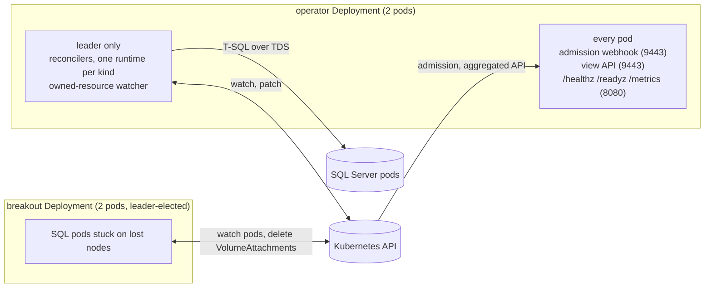

# Architecture overview

This chapter describes the components of the operator, its reconciliation runtime, the sequence of an AG reconcile, and how status, admission, CRDs and the SQL Server image catalog are handled. The following chapters cover [availability group internals](availability.md), the [safety mechanisms](safety.md) and the [security model](security.md).

## Context

Always On availability groups were designed to run on top of a cluster manager, Windows Server Failover Clustering or Pacemaker. The cluster manager monitors the replicas, holds a quorum, decides when to fail over, and makes sure the old primary is stopped before a new one is promoted. SQL Server itself only replicates the log and enforces the commit rule. Kubernetes has no equivalent component: it reschedules pods and detects failed nodes, but has no notion of a primary replica or of a quorum.

The operator fills that role. It creates every AG with `CLUSTER_TYPE = NONE`, a mode in which SQL Server never fails over on its own, and performs the cluster manager's tasks from outside the engine. It detects the loss of a primary, establishes that the old primary can no longer write, promotes the secondary that holds every acknowledged commit, and moves the listener. Around this core, it also manages instances, databases, logins, configuration, Agent jobs, stored procedures and TDE.

The design follows one rule throughout: when the operator cannot establish that an action is safe, it does not take it. A failover that cannot confirm the old primary is stopped is aborted, an action that would lose data waits for an approval, and both cases are reported through events and conditions.

## Components

The Helm chart installs two Deployments.

The operator pods all serve the admission webhook and the view API, which therefore stay available while the leadership moves from one pod to another. Only the pod holding the Lease `mssql-operator-leader` runs the reconcilers ([`ReconcilerHostedService`](../../src/MsSqlOperator/Operator/Registration/ReconcilerHostedService.cs)).

The breakout controller runs in a separate Deployment, with its own ServiceAccount, and prefers nodes without SQL Server pods. It handles the SQL Server pods that Kubernetes will not recreate because their node stopped responding ([Lost nodes](availability.md#lost-nodes)). Keeping it apart has two purposes: the loss of a primary's node should not also take down the controller that relocates that primary, and the permission to delete VolumeAttachments should belong to an identity that does nothing else.

The decision logic of the high-availability protocol (elections, timing budget, supervisor) lives in a third project, [`MsSqlOperator.Core`](../../src/MsSqlOperator.Core/), which performs no I/O; a banned-symbols list enforces this. Because it is pure, it can be simulated with injected faults on every build ([Decision core and simulation](safety.md#decision-core-and-simulation)).

## Reconciliation runtime

The operator does not use an operator SDK. It started on KubeOps and replaced it with its own runtime, to control the parts that matter most when things fail: how a watch recovers, what a requeue means, how finalizers are patched, and what a pod does when it loses the leadership. The runtime is in [`src/MsSqlOperator/Operator/`](../../src/MsSqlOperator/Operator/) and follows the model of Go's `controller-runtime`.

### Work queue and workers

For each kind that has a controller, an [`EntityRuntime`](../../src/MsSqlOperator/Operator/Runtime/EntityRuntime.cs) watches the resources cluster-wide and pushes `namespace/name` keys into a [`WorkQueue`](../../src/MsSqlOperator/Operator/Runtime/WorkQueue.cs), consumed by two workers per kind (`operator.workerCount`). A worker never acts on the content of the event that woke it up: it fetches the current object from the API server, then calls the controller. Decisions are therefore level-triggered. A burst of events on one object results in a single reconcile, and a lost event has no consequence, since the next reconcile reads the same state anyway.

The queue itself provides the following guarantees:

- at most one reconcile runs for a given key; an event received during a reconcile marks the key dirty, and the key is queued again when the reconcile ends;
- adding a key that is already queued has no effect;
- a failed reconcile is retried with exponential backoff (2, 4, 8 seconds and so on, up to 2 minutes), and the counter resets on success;
- a successful reconcile that does not request a requeue is scheduled again after 5 minutes, with ±20 % jitter, so that drift is corrected even when the resource itself does not change.

Requeue delays are capped at 24 hours, because .NET timers fail beyond about 49 days. Longer intervals, such as a yearly certificate rotation, are reached through successive capped waits, each one recomputing the actual deadline.

### Watch robustness

A watch is a long-lived HTTP stream, and such streams tend to fail silently. [`ResourceWatcher`](../../src/MsSqlOperator/Operator/Runtime/ResourceWatcher.cs) and [`K8sWatchSession`](../../src/MsSqlOperator/Operator/Runtime/K8sWatchSession.cs) open every watch with `timeoutSeconds=300`, so the API server closes it every 5 minutes and a half-open connection cannot remain unnoticed. A normal close resumes from the last `resourceVersion`, and a full relist happens only after an error or a `410 Gone`. Bookmarks are enabled, so the `resourceVersion` keeps advancing when nothing changes.

A relist also catches deletions that were missed while the stream was down: keys that the runtime knew but that are absent from the new list are queued, the worker finds the object gone and runs the deletion path. A malformed object in a stream is logged and skipped rather than stopping the watch, and after five consecutive failures the log level is raised from warning to error, so that a persistent outage stands out from transient noise.

### Owned resources

Without a watch on the objects it creates, the operator would only notice a deleted Service at the next five-minute resync. [`OwnedResourceWatcher`](../../src/MsSqlOperator/Operator/Runtime/OwnedResourceWatcher.cs) therefore watches them cluster-wide, by label: StatefulSets, Services, ConfigMaps, PodDisruptionBudgets, CiliumNetworkPolicies, the SQL Server pods, and the key Secrets and PVCs, which have no owner reference by design. Secrets are reduced to their metadata before being processed, so no Secret data is cached.

A change on one of these objects queues its owner, found through the controller owner reference or the owner labels. Status-only updates do not change `metadata.generation` and do not trigger a reconcile, which keeps pod readiness changes from causing reconcile storms. If Cilium is not installed, the CiliumNetworkPolicy watch stops.

### Finalizers

Resources that own objects in SQL Server (logins, jobs, procedures, a database, an AG membership) carry a finalizer, so that these objects are cleaned up before the resource disappears. The runtime adds and removes only its own finalizer entry, with a JSON patch guarded by the object's `resourceVersion`, and retries on conflict, so the finalizers of other controllers are never overwritten. The finalizers are in [`src/MsSqlOperator/Finalizers/`](../../src/MsSqlOperator/Finalizers/). When a target no longer exists, the annotation `mssql-operator.evariops.com/force-finalize: "true"` lets the deletion complete.

### Leader election

The Lease lasts 30 seconds, is renewed within 20 seconds, and renewal is retried every 2 seconds. A pod that loses the Lease does not try to recover it in-process, since another pod may already be reconciling. It logs at `Critical` level, stops, and calls `Environment.Exit` if stopping takes more than 5 seconds; Kubernetes then restarts it, and it rejoins the election with a clean state. At startup, [`LeaseTiming`](../../src/MsSqlOperator/Operator/Registration/LeaseTiming.cs) rejects any configuration in which the exit delay, the renew deadline and the retry period add up to the Lease duration or more, so that a former leader is always gone before a new one can start.

A pod that stops gracefully, during a drain or a rollout of the operator, releases the Lease once its reconcilers have stopped ([`LeaseRelease`](../../src/MsSqlOperator/Operator/Registration/LeaseRelease.cs)): it empties the holder and sets the duration to one second, as client-go does. The other pod takes the Lease on its next retry, within about 2 seconds, instead of waiting 30 seconds for it to expire. The breakout controller releases its own Lease the same way. If the release fails, the Lease expires as before.

A short window remains between the actual expiry of the Lease and the moment the former leader notices it, and Kubernetes leader election alone cannot close it. The operator epoch, checked on the SQL Server side, covers that window ([Operator epoch](safety.md#operator-epoch)).

### Timeouts and health probes

A reconcile that never ends holds a worker forever, and for an AG that would mean nobody monitors the primary any more. Each kind therefore has a reconcile timeout, defined in [`OperatorOptions`](../../src/MsSqlOperator/Operator/Registration/OperatorOptions.cs): 10 minutes by default, 2 minutes for `SqlAvailabilityGroup`, whose reconcile is also its health check, and 4 hours for `SqlAvailabilityGroupDatabase`, which follows long initialization backups.

The liveness probe `/healthz` fails when a kind has work waiting longer than any healthy reconcile could take (three resync intervals, or twice the timeout), which means its workers are stuck and only a restart can free them. The readiness probe `/readyz` checks the API server and the owned-resource watches; a watch that stays silent for more than twice its rotation interval makes the pod NotReady.

## Sequence of an AG reconcile

Controllers converge in small idempotent steps and record their progress in `status`, without assuming that the previous reconcile completed. The [`SqlAvailabilityGroupController`](../../src/MsSqlOperator/Controllers/SqlAvailabilityGroupController.cs) is the most demanding one: it runs every 10 seconds (`failover.healthCheckIntervalSeconds`), and its reconcile is the health check of the AG. The order of its steps matters, so it is worth following one reconcile of a running AG.

The reconcile starts with the Kubernetes objects. Once a minute, or when the spec changed, it re-applies the ConfigMap, the StatefulSet, the Services, the PodDisruptionBudget and the network policy. This step used to run on every reconcile, which slowed the health check down beyond a few dozen AGs. A failure here, such as a quota or a policy webhook rejecting a patch, is reported but does not stop the rest of the reconcile, because an API server problem must not switch off failover detection. The reconcile then converges the `sa` password on every replica, since every following step logs in with it, and contains an old primary that is coming back after a recent failover ([Return of the old primary](availability.md#return-of-the-old-primary)).

Next comes the health read. On every replica, the controller reads from `sys.dm_hadr_*` the role the replica reports, the connection and synchronization state of each replica, and the synchronization state and hardened LSN of each database. These reads use the probe profile: 3 seconds to connect, 5 seconds per command, no retry. Each connection must also answer a `SELECT 1` within 5 seconds before it is used, and a replica whose probe exceeds its deadline is counted unreachable instead of being waited for. These rules come from the chaos campaigns. A frozen primary keeps its TCP sessions open, so a pooled connection to it opens without any round trip, and its first command then ignores cancellation; this once blocked the whole reconcile for seven and a half minutes. A connection that fails the check is now dropped and its pool cleared, so the next probe has to log in again, which a frozen server cannot do. Unpooled probe connections were tried first and abandoned, because the SQL client serializes unpooled opens, and the open blocked on the frozen primary made a healthy secondary's open time out behind it.

With the health report in hand, the controller decides failovers, in [`AgFailoverOrchestrator`](../../src/MsSqlOperator/Services/SqlServer/AgFailoverOrchestrator.cs): a forced or planned failover requested by annotation, or an automatic failover when no primary answers. When a failover changes the topology, the reconcile ends there, and the next one starts within a second to observe the new primary. Otherwise, the rolling update can advance by at most one pod, and only if the AG is healthy ([`AgRollingUpdateOrchestrator`](../../src/MsSqlOperator/Services/SqlServer/AgRollingUpdateOrchestrator.cs)).

The controller then updates the role and readability labels of the pods, which the listener Services select on. When no primary answered, labels are left as they are: removing the writer label is part of the failover decision, and must not result from a single missed probe. On the primary, it converges read-only routing, availability modes, `REQUIRED_SYNCHRONIZED_SECONDARIES_TO_COMMIT` and the backup preference, and handles the replicas that hold the log back. It grows the volumes that are 80 % full. Once a minute, it also handles replicas on lost nodes, endpoint keys, service master key backups, memory alignment, durability tracking and the database summary. The reconcile ends by writing the phase and conditions, publishing events, and requeueing.

The [`SqlAvailabilityGroupDatabaseController`](../../src/MsSqlOperator/Controllers/SqlAvailabilityGroupDatabaseController.cs) runs alongside, every 15 to 30 seconds, and immediately when the AG state read shows a transition that concerns its database, such as a new primary or a database suspended or resumed. It owns everything that is specific to a database: the initialization backup, the join, seeding, resuming stalled secondaries, re-seeding and log backups.

## Status, events, metrics and view API

Early versions stored per-target, per-database and per-procedure results in `status`, along with rotation history and job history. Two problems followed. A `SqlTdeCertificate` reconciled for an hour accumulated a 1.6 MB `status.rotation.history`, beyond the etcd object size limit, and could no longer save its status at all. And since each status write rewrites the whole object in etcd, large statuses combined with frequent reconciles produced a heavy write load.

Since then, data that grows with the number of managed objects, or that changes without a spec change, is not stored in etcd. Each kind of data goes where it fits:

- the status holds the phase, the conditions, `observedGeneration` and a few counters, and its size is bounded;
- events record what happened (failovers, re-seeds, backups, withheld actions) and are deduplicated by reason;
- Prometheus metrics carry values that change over time, such as replication lag, queue depth and gateway decisions;
- the view API serves detailed live data, read from SQL Server on request.

The [view API](../../src/MsSqlOperator/Operator/ViewApi/) is a Kubernetes aggregated API (`view.mssql-operator.evariops.com`). A request such as `kubectl get agreplicastates` goes through the API server, with its usual authentication and RBAC, to the operator, which answers from the replicas' DMVs. Results are cached for 10 seconds, watches are not supported, and an unreachable server is skipped rather than failing the whole list. The plans of the [actuation gateway](safety.md#actuation-gateway) are held in the leader's memory, so a follower that receives an `operatorplans` request forwards it to the leader over mutually authenticated TLS, and the answer does not depend on which pod received the request.

## Admission

The validating webhooks in [`src/MsSqlOperator/Validators/`](../../src/MsSqlOperator/Validators/) reject manifests that the operator would refuse to apply, among which:

- privileged or root pods, and images from registries outside the allow-list;
- floating tags and version downgrades;
- `sp_configure` options that allow code execution, without explicit opt-in;
- SQL identifiers outside a restricted character set.

Immutable fields are rejected by the webhook, and several of them are also enforced by CEL rules in the CRDs, which the API server applies even without the webhook: the storage classes and optional volumes of an instance or an AG, the replica count and endpoint port of an AG, and the target and name of a `SqlDatabase`.

A webhook can be bypassed: it does not see objects created before it was installed, nor updates to the `/status` subresource. The rules that protect against code execution are therefore checked a second time when they are applied, namely the `sp_configure` allow-list, the opt-in for privileged roles and the opt-in for deployments as `sa`. The webhook has no `DELETE` handling, since deletions are covered by finalizers, and it is served over TLS only; its paths return 404 on the plain-HTTP metrics port.

## CRD schemas

The CRD files in [`charts/mssql-operator/templates/crds/`](../../charts/mssql-operator/templates/crds/) contain descriptions, validations and CEL rules written by hand, which no generator produces. The code still owns the schema: the generator in [`Operator/Codegen/`](../../src/MsSqlOperator/Operator/Codegen/) derives it from the C# entities, and the tests `CrdGeneratedSchemaMatchesCommittedTests` and `CrdYamlDriftTests` fail when the committed YAML and the code disagree. A new field is therefore added in both places, and the files are never regenerated wholesale, which would drop the hand-written rules. The RBAC is not generated either: the ClusterRole in [`rbac.yaml`](../../charts/mssql-operator/templates/rbac.yaml) is maintained by hand, and a test checks that every kind the code patches is granted.

## SQL Server image catalog

The webhook rejects SQL Server builds that Microsoft never published, for example `2022-CU5-ubuntu-22.04`, since the Ubuntu 22.04 images start at CU10. It does not query the registry at admission time, so that admission does not depend on `mcr.microsoft.com` and keeps working in air-gapped clusters. Instead, `dotnet run --project src/MsSqlOperator -- refresh-images` regenerates [`SqlServerPublishedTags.g.cs`](../../src/MsSqlOperator/Configuration/SqlServerPublishedTags.g.cs), a snapshot of the published tags committed with the source and reviewed like code. A weekly workflow ([`refresh-sql-images.yml`](../../.github/workflows/refresh-sql-images.yml)) runs the command and opens a pull request when the list changes. A tag missing from the snapshot is accepted with a warning, so that a CU released after the operator remains usable, and tests fail when the default build falls behind the latest CU in the snapshot.

## Code layout

- [`src/MsSqlOperator/Controllers/`](../../src/MsSqlOperator/Controllers/): one controller per kind, which sequences the work and owns the status.
- [`src/MsSqlOperator/Services/SqlServer/`](../../src/MsSqlOperator/Services/SqlServer/): all T-SQL, including AG management, the failover and rolling update orchestrators, backups, keys, the ownership registry and the quorum watchdog. A governance test keeps SQL text in these classes.
- [`src/MsSqlOperator/Services/Kubernetes/`](../../src/MsSqlOperator/Services/Kubernetes/): StatefulSet, Service and network policy builders, volume auto-grow, rollout budget, event publisher.
- [`src/MsSqlOperator/Services/Actuation/`](../../src/MsSqlOperator/Services/Actuation/): the actuation gateway and its plans.
- [`src/MsSqlOperator/Services/Control/`](../../src/MsSqlOperator/Services/Control/): control records, epoch, durability profile, listener routing, election shell.
- [`src/MsSqlOperator/Services/Health/`](../../src/MsSqlOperator/Services/Health/): AG health checker, state store, event-driven supervisor (safety level 3).
- [`src/MsSqlOperator/Services/Breakout/`](../../src/MsSqlOperator/Services/Breakout/): breakout controller and the fencer used by failovers.
- [`src/MsSqlOperator/Services/ConnectionFactory/`](../../src/MsSqlOperator/Services/ConnectionFactory/): SQL connection profiles, per-server limits, circuit breakers.
- [`src/MsSqlOperator/Operator/`](../../src/MsSqlOperator/Operator/): runtime, webhooks, view API, CRD generation.
- [`src/MsSqlOperator/Entities/`](../../src/MsSqlOperator/Entities/): resource types.
- [`src/MsSqlOperator.Core/`](../../src/MsSqlOperator.Core/): decision logic without I/O.
- [`charts/mssql-operator/`](../../charts/mssql-operator/): Helm chart and CRDs.
